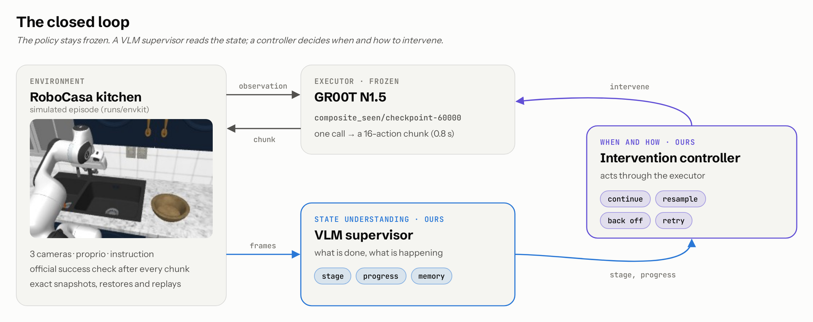
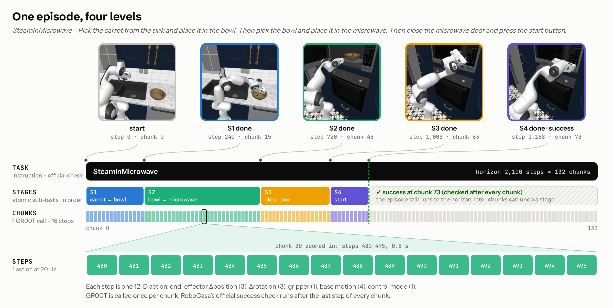

# ECE 780: steering a frozen GR00T N1.5 on RoboCasa365

This is a fork of [RoboCasa](https://github.com/robocasa/robocasa); the upstream README is in
[README_robocasa.md](README_robocasa.md). Our work is in [`runs/`](runs/README.md).

## Goal
The frozen GR00T N1.5 policy can already solve many RoboCasa365 kitchen tasks. Some of its own samples succeed, but a
plain rollout often fails partway. We keep the policy frozen and add a closed loop around it:
- a **VLM supervisor** understands the state: which stage is done, whether progress is being made, and what happened
  before;
- an **intervention controller** decides when and how to act: continue, resample, back off, or retry.



Preliminary evidence, from the earlier pipeline ([runs/README.md](runs/README.md)):
- choosing among GR00T's own samples with a simulator oracle raises KettleBoiling from 65 % to 97 %;
- choosing at the few chunks that decide a stage gains +25 points, while choosing at random chunks gains nothing.

## Tasks
RoboCasa365 evaluates on 50 target tasks in three splits. Each split has its own post-trained checkpoint.

| split | tasks | what they are | in pretraining? | GR00T N1.5 success (paper) |
|---|---|---|---|---|
| Atomic-Seen | 18 | one skill: `OpenDrawer`, `TurnOnStove`, `PickPlaceCounterToCabinet`, ... | yes | 68.5 % |
| **Composite-Seen** | **16** | several skills in sequence: `KettleBoiling`, `SteamInMicrowave`, ... | yes | 40.6 % |
| Composite-Unseen | 16 | other composite tasks: `ArrangeTea`, `PanTransfer`, ... | no | 42.1 % |

We work on the 16 **Composite-Seen** tasks:

| task | stages | horizon (chunks) | task | stages | horizon (chunks) |
|---|---|---|---|---|---|
| KettleBoiling | 2 | 94 | SetUpCuttingStation | 2 | 150 |
| PreSoakPan | 3 | 150 | StirVegetables | 4 | 150 |
| StackBowlsCabinet | 2 | 132 | SearingMeat | 3 | 272 |
| SteamInMicrowave | 4 | 132 | PackIdenticalLunches | 4 | 244 |
| PrepareCoffee | 2 | 113 | DeliverStraw | 2 | 160 |
| ScrubCuttingBoard | 2 | 75 | GetToastedBread | 2 | 188 |
| WashLettuce | 2 | 104 | LoadDishwasher | 3 | 113 |
| RinseSinkBasin | 2 | 85 | StoreLeftoversInBowl | 3 | 160 |

## Task, stage, chunk, step


- **Success** is RoboCasa's own `_check_success()`, unchanged, read after the last step of every chunk. An episode
  succeeds if any chunk end succeeds, as in GR00T's official eval. It runs to the horizon.
- **Stages** (`runs/envkit/stages.py`) are read from the current state, so a later chunk can undo one. The last stage
  is the official success.

## Checkpoints
GR00T N1.5 from `robocasa/robocasa365_checkpoints` on Hugging Face, under `checkpoints/gr00t_n1-5/foundation_model_learning/`:

| checkpoint | trained on | used here |
|---|---|---|
| `target_posttraining/composite_seen/checkpoint-60000` | pretraining + Composite-Seen post-training | **yes, all experiments** |
| `target_posttraining/composite_unseen/checkpoint-60000` | pretraining + Composite-Unseen post-training | |
| `target_posttraining/atomic_seen/checkpoint-60000` | pretraining + Atomic-Seen post-training | |
| `pretraining/checkpoint-80000` | pretraining only (300 tasks) | |

## Using this repo
```
runs/envkit/          the environment for every experiment: episodes, frozen scenes, snapshots, replays, stages, GR00T client
runs/envkit/tests/    the tests that must pass before experiments
runs/2026xxxx_*/      experiment records (README + results)
runs/_handoff/        rebuilding the setup on a new machine (code commits, python env, checkpoints, datasets)
```
To install, follow [runs/_handoff/README.md](runs/_handoff/README.md). Then, from the repository root:
```bash
export CUDA_DEVICE_ORDER=PCI_BUS_ID CUDA_VISIBLE_DEVICES=1 MUJOCO_EGL_DEVICE_ID=1   # a free GPU
setsid nohup runs/envkit/servers.sh 1 5581 2 > /dev/null 2>&1 < /dev/null &         # 2 GR00T servers, ports 5581-5582
envs/groot/bin/python -I                                                            # the GR00T python
```
```python
import sys; sys.path.insert(0, "runs/envkit")
import envkit, policy, stages
ep = envkit.Episode("SteamInMicrowave", 2)                 # frozen scene (task, seed 0-29)
policy.rollout(ep, policy.Client(5581), tag="demo",        # GR00T until the horizon, seeded chunks
               on_chunk=lambda e: print(e.t, stages.track(e)["stage"]))
print(ep.success, ep.success_step)
ep.close()
```
Snapshots, branching (resample / back-off), replays and the rules are in **[runs/envkit/README.md](runs/envkit/README.md)**.

## Testing
Run the tests from `runs/envkit/tests`, with the GPU variables above and the servers up:
`../../../envs/groot/bin/python -I run_tests.py <test> <task> <seed>`. Each run prints one json line.

| what | test | what must hold | result (2026-11-05) |
|---|---|---|---|
| Scenes and reset | `check` | the frozen scene loads exactly; RoboCasa's reset reproduces it | 480 / 480 |
| Restore | `check`, `policy` | snapshot -> run -> restore gives the same state; re-running gives the same trajectory, also after another branch; with random actions and at every stage change of a GR00T run | 480 / 480, 133 points in 48 runs |
| Replay | `check`, `policy` | recorded actions give the same states, success and stages, chunk by chunk, in a new process | 6,966 chunks |
| Policy sampling | `sampling` | same observation + seed gives the same chunk (also on another server and after a restore); another seed gives another chunk | 16 / 16 |
| Success and stages | `stages`, `policy` | the stage tracker only reads the env; official success implies every stage | 48 / 48 |

To run everything: `./campaign.sh <gpu> 16` (freeze and check 480 scenes), `./policy_tests.sh <gpu> 8 0 2 "5581 5582"`
(48 GR00T runs), then `python3 summary.py`. Camera images are the one thing that is not exact. The official rendering
(MSAA 4) changes a few edge pixels at random, so live GR00T runs can diverge, and a specific episode is reproduced by
replaying its actions. See [runs/envkit/tests/README.md](runs/envkit/tests/README.md).
